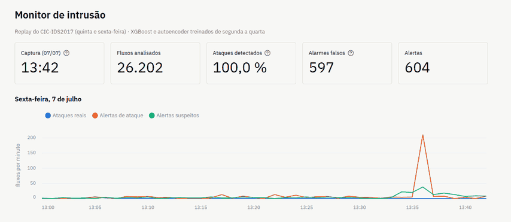
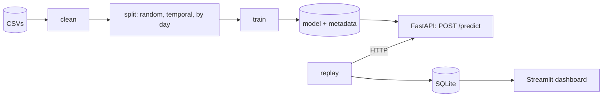

# Network intrusion detection with machine learning

[](https://github.com/IsabelaaTeixeira/ids-ml/actions/workflows/ci.yml)
· [Versão em português](README.pt-BR.md)

An end-to-end intrusion detection system on the network flows of
[CIC-IDS2017](https://www.unb.ca/cic/datasets/ids-2017.html): careful data cleaning, an evaluation
without leakage, a comparison between a supervised classifier and anomaly detectors on attacks never
seen in training, and the result served by an API in Docker, with a live demo.



## The question

> How much does a supervised model lose on attacks it has never seen, and how much of that can an
> anomaly detector recover, at what cost in false positives?

CIC-IDS2017 has a different set of attacks on each day of capture. Training on Monday to Wednesday
and testing on Thursday and Friday puts in the test only attack families that the models never saw.

## Key results

Recall on the Thursday and Friday attacks, with every model's threshold set to 1 % false positives
on the validation set, before looking at the test:

| Family (test flows) | XGBoost that knows the family | XGBoost | Isolation Forest | Autoencoder | XGBoost + autoencoder |
|---|---|---|---|---|---|
| PortScan (90,255) | 0.999 | 0.010 | 0.003 | 0.092 | 0.100 |
| DDoS (128,012) | 0.999 | 0.639 | 0.000 | 0.254 | 0.703 |
| Bot (1,953) | 0.000 | 0.000 | 0.008 | 0.003 | 0.003 |
| WebAttack (2,143) | 0.991 | 0.933 | 0.000 | 0.000 | 0.933 |
| Infiltration (36) | 0.000 | 0.000 | 0.750 | 0.722 | 0.722 |
| **All five** | **0.990** | **0.381** | **0.001** | **0.184** | **0.454** |

The first column is the ceiling: an XGBoost trained on the early part of every day, which knows
these families. Infiltration stays out of its training (36 flows are too few), and its Bot flows
change behavior after the training period.

- **A random split hides the data's problems.** The same XGBoost scores 0.957 macro-F1 when the
  data is shuffled and 0.801 when the split respects time. On the corrected dataset (below), the
  gap disappears: it came from labeling errors that the random split spreads across training and
  test.
- **On unseen attacks, the classifier drops from 99.0 % to 38.1 % recall.** What it still catches
  resembles its training data: DDoS and web attacks hit the same server and port as Wednesday's DoS.
- **Anomaly detectors recover little at that operating point, but they are the only ones that catch
  the infiltration.** The autoencoder ranks attacks well (ROC-AUC 0.96 to 0.99 on three families)
  and would reach 63.6 % at 2 % false positives, but that threshold cannot be chosen without
  examples of the attacks.
- **Together, classifier and autoencoder catch 45.4 %.** At a realistic base rate (1,000 attacks
  per million normal flows), that would still mean about 42 false alarms for each true one.
- **Much of the "error" is in the labels.** The victim's responses to the attacker and an internal
  port scan by the infiltrated host are labeled as normal traffic. Without them, the false-positive
  rate on the test is about 1 %, as on validation.

### On the corrected dataset

Engelen et al. rebuilt CIC-IDS2017 from the packet captures, with a fixed flow extractor and new
labels ([their page](https://intrusion-detection.distrinet-research.be/CNS2022/)). Running the same
pipeline and models on that version changes the picture
([notebook 04](notebooks/04_conjunto_corrigido.ipynb)):

| | Original | Corrected |
|---|---|---|
| XGBoost macro-F1, random split | 0.957 | 0.997 |
| XGBoost macro-F1, temporal split | 0.801 | 0.997 |
| Unseen attacks, XGBoost recall | 0.381 | 0.435 |
| Unseen attacks, autoencoder recall | 0.184 | 0.609 |
| Unseen attacks, XGBoost + autoencoder | 0.454 | 0.994 |
| Test false-positive rate (target 1 %) | 2.1 % to 8.4 % | 1.5 % to 1.7 % |

- **The gap between random and temporal splits disappears.** The temporal split was exposing errors
  in the data, not a harder problem: the Bot and DDoS flows that "failed" were mislabeled.
- **With clean labels and flows, anomaly detection works.** The port scans that slipped through
  become 99 % detectable, and classifier plus autoencoder catch 99.4 % of the unseen attacks. The
  pessimistic result on the original data was largely an artifact of the dataset. Bot traffic is
  still missed, and 3 % false positives is still a lot of alarms at a realistic base rate.
- **Data quality barely shows on a random split** (0.957 against 0.997), which is how most published
  results are measured. It changes the conclusion on the protocols that measure generalization.

### On another network

The models trained on the corrected CIC-IDS2017 were then run on the corrected
**CSE-CIC-IDS2018**: same lab and same flow extractor, but other machines, on a network in AWS, with
63 million flows ([notebook 05](notebooks/05_outra_rede.ipynb)).

| | 2017 threshold | Threshold recalibrated on one normal day of 2018 |
|---|---|---|
| False-positive rate | 2.9 % to 10.7 % | 0.02 % to 0.3 % |
| Attacks detected by XGBoost + autoencoder | 18 % | 1.3 % |

- **The models do not transfer to another network.** With the 2017 threshold they raise millions of
  false alarms, and DoS and DDoS (91 % of the attacks) go unrecognized. Recalibrating with normal
  traffic only brings the alarms down by taking detection with them: a deployed IDS needs attack
  examples, or retraining, on its own network.
- **The protocol shortcut is real.** The classifier, which only saw TCP attacks, catches 0.1 % of a
  UDP DDoS; the autoencoder catches all of it, even after recalibration.
- **The TCP window hurts transfer.** Without it, the XGBoost ranks attacks better in five of seven
  families (DDoS ROC-AUC from 0.29 to 0.76), which supports the suspicion that it identifies the
  2017 machines rather than the attacks.
- **What does transfer:** port scans (every model) and, with the 2017 threshold, Bot, web attacks
  and SSH brute force.

## What was wrong with the data

- **A 12-hour clock without AM/PM in every file.** Without the fix, 1.47 million timestamps (52 %)
  would be out of order. The corrected times match the official attack schedule.
- **Duplicates:** 332,674 rows, removed before any split. They were 43 % of the PortScan flows and
  45 % of the SSH-Patator ones.
- **Shortcuts.** The destination port alone reaches 0.33 macro-F1, so it stays out of the model.
  All attacks are TCP. The initial TCP window identifies the attacking machine: without it,
  macro-F1 falls from 0.957 to 0.690.
- **Smaller fixes:** 288,602 empty lines, 35 integer overflows and 10 redundant features (70 → 60).

## How it is built



- **Data pipeline** (`nids data verify|clean|split`): checksums of the raw files, small tested
  cleaning rules, a quality report and invariants checked before writing.
- **Three evaluation protocols:** random (kept only as a counterexample), temporal (known attacks in
  the future) and by day (attacks never seen).
- **Models:** XGBoost and Random Forest; Isolation Forest and an autoencoder trained only on normal
  traffic. Each model is saved with its features, classes, threshold and library versions.
- **Service:** a FastAPI API gives each flow a verdict (`attack` with the family, `suspicious` or
  `benign`). With real test flows, it reproduces the offline evaluation counts exactly.
- **Engineering:** locked environment (uv), validated configuration, 83 tests written at agreed
  boundaries, CI with lint, tests and Docker builds, and 9 architecture decision records.

## Run it

Requirements: [Git](https://git-scm.com/), [uv](https://docs.astral.sh/uv/) and, for the API and
the demo, [Docker](https://docs.docker.com/get-started/get-docker/).

```bash
uv sync                          # environment from uv.lock
uv run pytest -m "not data"      # tests that do not need the dataset
```

### The API in two minutes, without the dataset

The trained models are attached to the
[v1.1.0 release](https://github.com/IsabelaaTeixeira/ids-ml/releases/tag/v1.1.0):

```bash
curl -LO https://github.com/IsabelaaTeixeira/ids-ml/releases/download/v1.1.0/models-original.zip
unzip models-original.zip        # creates models/
docker compose up --build
curl -X POST http://localhost:8000/predict -H "content-type: application/json" -d @docs/exemplo_predict.json
```

On PowerShell, use `curl.exe` and `Expand-Archive models-original.zip -DestinationPath .`.
`models-corrigido.zip` holds the same models trained on the corrected dataset (it creates
`models/improved/`). They expect flows from the fixed extractor: start the API with
`NIDS_MODEL_DIR=/models/improved docker compose up` and send
[docs/exemplo_predict_corrigido.json](docs/exemplo_predict_corrigido.json).

The dataset is downloaded by hand; see [data/README.md](data/README.md). Then:

```bash
uv run nids data verify && uv run nids data clean && uv run nids data split
uv run nids train configs/experiments/xgb_temporal.yaml   # one YAML per experiment
uv run nids train configs/experiments/ae_unseen.yaml
```

To repeat everything on the corrected dataset, extract `CICIDS2017_improved.zip` (from the
authors' page) into `data/external/cicids2017_improved/` and add
`--config configs/data_improved.yaml` to the data and train commands. Results go to separate folders.
Then, with `CSECICIDS2018_improved.zip` in `data/external/`,
`uv run nids score data/external/CSECICIDS2018_improved.zip --model xgb_temporal --model ae_unseen`
scores its 63 million flows in chunks, straight from the zip (about an hour), for notebook 05.

### API

```bash
docker compose up --build        # http://localhost:8000/docs
curl -X POST http://localhost:8000/predict -H "content-type: application/json" -d @docs/exemplo_predict.json
```

`POST /predict` takes up to 1,000 flows, each with the 60 features of the cleaned dataset, and
returns one verdict per flow. [docs/exemplo_predict.json](docs/exemplo_predict.json) holds three real
test flows (a DDoS, an infiltration and a normal one) that get the three verdicts. On PowerShell,
use `curl.exe`. Without Docker: `uv run uvicorn nids.serving.api:create_app --factory`.

Before exposing the API beyond your machine, set `NIDS_API_KEY` (clients then send it in the
`X-API-Key` header) and `NIDS_RATE_LIMIT` (requests per minute per client); both are off by default
for the local demo ([ADR 0012](docs/adr/0012-protecao-da-api.md)). `GET /metrics` exposes verdict
counts and `/predict` latency in Prometheus format.

### Live demo

```bash
docker compose --profile demo up --build    # dashboard at http://localhost:8501
```

The replay sends the Thursday and Friday test (nearly 1 million flows) to the API in time order, one
minute of capture per second, and the dashboard shows alerts, hits and misses as they happen. The
full replay takes about 20 minutes and ends at the same 45.4 % as the offline evaluation. The demo
API serves the XGBoost trained on Monday to Wednesday: the default one was trained on the early part
of Thursday and Friday, and the replay refuses to run with models that may have seen its test data.

To watch only Friday afternoon (PortScan and DDoS):

```bash
docker compose --profile demo run --rm replay nids replay --api=http://api-demo:8000 \
  --file=/data/processed/unseen/test.parquet --db=/demo/replay.db --start="2017-07-07 13:00"
```

On Git Bash for Windows, start the command with `MSYS_NO_PATHCONV=1`. Without Docker, run in three
terminals: `NIDS_CLASSIFIER=xgb_unseen uv run uvicorn nids.serving.api:create_app --factory`,
`uv run nids replay` and `uv run streamlit run dashboard/app.py`.

## Limitations

- The dataset was generated in a lab in 2017, with synthetic normal traffic, and its original labels
  have known errors. The main experiments were repeated on the corrected version, but its
  differences mix new labels and differently built flows, and the two effects cannot be separated.
- The models only apply to flows described by CICFlowMeter features. Zeek or Suricata would need a
  mapping or retraining.
- All attacks in CIC-IDS2017 are TCP: on CSE-CIC-IDS2018, the classifier misses a UDP DDoS that only
  the autoencoder catches. And the models do not transfer to another network without retraining.
- The anomaly threshold is chosen without examples of the attacks, and some families are tiny
  (36 infiltration flows, 11 Heartbleed).
- The API has no authentication or rate limit, and the demo replays flows extracted after the
  capture, so alert latency was not measured.

## Documentation (in Portuguese)

- [docs/ARQUITETURA.md](docs/ARQUITETURA.md): architecture, protocols and roadmap.
- [docs/adr/](docs/adr/): the decisions, one per record.
- [notebooks/](notebooks/): exploratory analysis, supervised models and anomaly detection.

## Repository layout

| Folder | Contents |
|---|---|
| `src/nids/` | Data, models, evaluation, API and replay |
| `dashboard/` | Demo dashboard (Streamlit) |
| `docker/` | API and demo images |
| `tests/` | Automated tests |
| `configs/` | Data and experiment configuration |
| `notebooks/` | Analyses |
| `reports/` | Data quality, splits, metrics and figures |
| `docs/` | Architecture, decision records and examples |
| `data/` | Raw and processed data, outside git ([data/README.md](data/README.md)) |

Author: Isabela Teixeira e Cerqueira.
