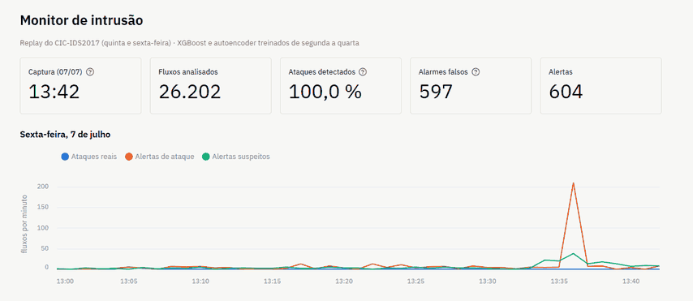
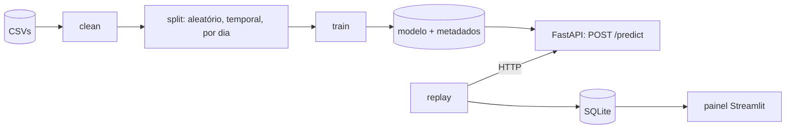

# Detecção de intrusão em rede com aprendizado de máquina

[](https://github.com/IsabelaaTeixeira/ids-ml/actions/workflows/ci.yml)
· [English version](README.md)

Um sistema de detecção de intrusão de ponta a ponta sobre os fluxos de rede do
[CIC-IDS2017](https://www.unb.ca/cic/datasets/ids-2017.html): limpeza cuidadosa dos dados, uma
avaliação sem vazamento, uma comparação entre um classificador supervisionado e detectores de
anomalia diante de ataques que nunca apareceram no treino, e o resultado servido por uma API em
Docker, com uma demonstração ao vivo.



## A pergunta

> Quanto um modelo supervisionado perde diante de ataques que nunca viu, e quanto disso um detector
> de anomalias recupera, a que custo em falsos positivos?

No CIC-IDS2017, cada dia de captura tem um conjunto diferente de ataques. Treinar de segunda a quarta
e testar na quinta e na sexta deixa no teste só famílias de ataque que os modelos nunca viram.

## Principais resultados

Revocação nos ataques de quinta e sexta, com o limiar de cada modelo fixado em 1 % de falsos
positivos na validação, antes de olhar o teste:

| Família (fluxos no teste) | XGBoost que conhece a família | XGBoost | Isolation Forest | Autoencoder | XGBoost + autoencoder |
|---|---|---|---|---|---|
| PortScan (90.255) | 0,999 | 0,010 | 0,003 | 0,092 | 0,100 |
| DDoS (128.012) | 0,999 | 0,639 | 0,000 | 0,254 | 0,703 |
| Bot (1.953) | 0,000 | 0,000 | 0,008 | 0,003 | 0,003 |
| WebAttack (2.143) | 0,991 | 0,933 | 0,000 | 0,000 | 0,933 |
| Infiltration (36) | 0,000 | 0,000 | 0,750 | 0,722 | 0,722 |
| **As cinco** | **0,990** | **0,381** | **0,001** | **0,184** | **0,454** |

A primeira coluna é o teto: um XGBoost treinado com o começo de cada dia, que conhece essas
famílias. O Infiltration fica fora do treino dele (36 fluxos são poucos), e os fluxos de Bot mudam
de comportamento depois do período de treino.

- **A divisão aleatória esconde a dificuldade real.** O mesmo XGBoost marca 0,957 de macro-F1 com
  os dados embaralhados e 0,801 quando a divisão respeita o tempo: 15,6 pontos de inflação.
- **Diante de ataques inéditos, o classificador cai de 99,0 % para 38,1 % de revocação.** O que ele
  ainda pega se parece com o treino: o DDoS e os ataques web atingem o mesmo servidor e a mesma
  porta que os DoS de quarta.
- **Os detectores de anomalia recuperam pouco nesse ponto de operação, mas são os únicos que pegam a
  infiltração.** O autoencoder ordena bem os ataques (ROC-AUC de 0,96 a 0,99 em três famílias) e
  chegaria a 63,6 % com 2 % de falsos positivos, mas esse limiar não pode ser escolhido sem exemplos
  dos ataques.
- **Juntos, classificador e autoencoder pegam 45,4 %.** Numa taxa-base realista (1.000 ataques por
  milhão de fluxos normais), isso ainda daria cerca de 42 alarmes falsos para cada verdadeiro.
- **Boa parte do "erro" está nos rótulos.** As respostas da vítima ao atacante e uma varredura de
  portas interna feita pela máquina invadida estão rotuladas como tráfego normal. Sem elas, a taxa
  de falsos positivos no teste fica em cerca de 1 %, como na validação.

## O que estava errado nos dados

- **Um relógio de 12 horas sem AM/PM em todos os arquivos.** Sem a correção, 1,47 milhão de horários
  (52 %) ficariam fora de ordem. Os horários corrigidos batem com a agenda oficial dos ataques.
- **Duplicatas:** 332.674 linhas, removidas antes de qualquer divisão. Eram 43 % dos fluxos de
  PortScan e 45 % dos de SSH-Patator.
- **Atalhos.** A porta de destino sozinha chega a 0,33 de macro-F1, por isso fica fora do modelo.
  Todos os ataques são TCP. A janela TCP inicial identifica a máquina atacante: sem ela, a macro-F1
  cai de 0,957 para 0,690.
- **Correções menores:** 288.602 linhas vazias, 35 *overflows* de inteiro e 10 atributos redundantes
  (70 → 60).

## Como foi construído



- **Pipeline de dados** (`nids data verify|clean|split`): checksums dos arquivos originais, regras
  de limpeza pequenas e testadas, um relatório de qualidade e invariantes conferidas antes de gravar.
- **Três protocolos de avaliação:** aleatório (mantido só como contraexemplo), temporal (ataques
  conhecidos no futuro) e por dia (ataques nunca vistos).
- **Modelos:** XGBoost e Random Forest; Isolation Forest e um autoencoder treinados só com tráfego
  normal. Cada modelo é salvo com os atributos, as classes, o limiar e as versões das bibliotecas.
- **Serviço:** uma API em FastAPI dá a cada fluxo um veredito (`attack`, com a família,
  `suspicious` ou `benign`). Com fluxos reais do teste, ela reproduz exatamente as contagens da
  avaliação offline.
- **Engenharia:** ambiente travado (uv), configuração validada, 83 testes escritos em fronteiras
  combinadas, integração contínua com lint, testes e build das imagens Docker, e 9 registros de
  decisões de arquitetura.

## Como rodar

Pré-requisitos: [Git](https://git-scm.com/), [uv](https://docs.astral.sh/uv/) e, para a API e a
demonstração, [Docker](https://docs.docker.com/get-started/get-docker/).

```bash
uv sync                          # ambiente a partir do uv.lock
uv run pytest -m "not data"      # testes que não precisam do conjunto
```

O conjunto é baixado à mão; veja [data/README.md](data/README.md). Depois:

```bash
uv run nids data verify && uv run nids data clean && uv run nids data split
uv run nids train configs/experiments/xgb_temporal.yaml   # um YAML por experimento
uv run nids train configs/experiments/ae_unseen.yaml
```

### API

```bash
docker compose up --build        # http://localhost:8000/docs
curl -X POST http://localhost:8000/predict -H "content-type: application/json" -d @docs/exemplo_predict.json
```

`POST /predict` recebe até 1.000 fluxos, cada um com os 60 atributos do conjunto limpo, e devolve
um veredito por fluxo. [docs/exemplo_predict.json](docs/exemplo_predict.json) traz três fluxos reais
do teste (um DDoS, um da infiltração e um normal), que recebem os três vereditos. No PowerShell, use
`curl.exe`. Sem Docker: `uv run uvicorn nids.serving.api:create_app --factory`.

### Demonstração ao vivo

```bash
docker compose --profile demo up --build    # painel em http://localhost:8501
```

O replay manda o teste de quinta e sexta (quase 1 milhão de fluxos) à API em ordem cronológica, um
minuto de captura por segundo, e o painel mostra os alertas, os acertos e os erros enquanto
acontecem. O replay inteiro leva cerca de 20 minutos e termina nos mesmos 45,4 % da avaliação
offline. A API da demonstração serve o XGBoost treinado de segunda a quarta: o padrão treinou com o
começo de quinta e sexta, e o replay se recusa a rodar com modelos que podem ter visto o teste.

Para ver só a tarde de sexta (PortScan e DDoS):

```bash
docker compose --profile demo run --rm replay nids replay --api=http://api-demo:8000 \
  --file=/data/processed/unseen/test.parquet --db=/demo/replay.db --start="2017-07-07 13:00"
```

No Git Bash do Windows, comece o comando com `MSYS_NO_PATHCONV=1`. Sem Docker, rode em três
terminais: `NIDS_CLASSIFIER=xgb_unseen uv run uvicorn nids.serving.api:create_app --factory`,
`uv run nids replay` e `uv run streamlit run dashboard/app.py`.

## Limitações

- O conjunto foi gerado em laboratório em 2017, com tráfego normal sintético, e os rótulos originais
  têm erros conhecidos. Eles foram mantidos como publicados, e os resultados são reportados com e sem
  os fluxos mal rotulados.
- Os modelos só se aplicam a fluxos descritos pelos atributos do CICFlowMeter. Zeek ou Suricata
  exigiriam um mapeamento ou um novo treino.
- Todos os ataques do conjunto são TCP, então um modelo treinado aqui tende a considerar normal o
  tráfego UDP.
- O limiar do detector de anomalias é escolhido sem exemplos dos ataques, e algumas famílias são
  minúsculas (36 fluxos de infiltração, 11 de Heartbleed).
- A API não tem autenticação nem limite de requisições, e a demonstração reenvia fluxos extraídos
  depois da captura, então a latência dos alertas não foi medida.

## Documentação

- [docs/ARQUITETURA.md](docs/ARQUITETURA.md): arquitetura, protocolos e roteiro.
- [docs/adr/](docs/adr/): as decisões, uma por registro.
- [notebooks/](notebooks/): análise exploratória, modelos supervisionados e detecção de anomalias.

## Estrutura do repositório

| Pasta | Conteúdo |
|---|---|
| `src/nids/` | Dados, modelos, avaliação, API e replay |
| `dashboard/` | Painel da demonstração (Streamlit) |
| `docker/` | Imagens da API e da demonstração |
| `tests/` | Testes automatizados |
| `configs/` | Configuração dos dados e dos experimentos |
| `notebooks/` | Análises |
| `reports/` | Qualidade dos dados, divisões, métricas e figuras |
| `docs/` | Arquitetura, registros de decisão e exemplos |
| `data/` | Dados brutos e processados, fora do git ([data/README.md](data/README.md)) |

Autoria: Isabela Teixeira e Cerqueira.
