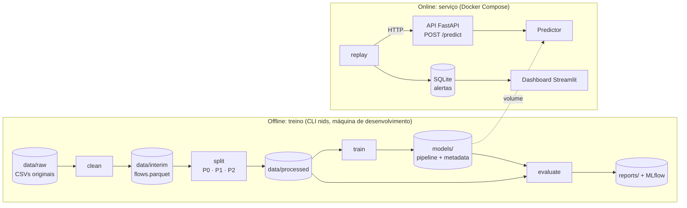

# Arquitetura do projeto: IDS com Machine Learning

> Status: proposta (28/10/2026). Documento vivo. Decisões grandes viram ADRs em `docs/adr/`.

## 1. Objetivo

O projeto conta uma história em quatro atos:

1. **Problema real:** detectar tráfego malicioso a partir de fluxos de rede (CIC-IDS2017).
2. **Dados tratados com cuidado:** os problemas conhecidos do dataset são encontrados, corrigidos e documentados com números.
3. **Avaliação honesta:** divisões sem vazamento e uma comparação entre um classificador supervisionado (bom em ataques conhecidos) e detectores de anomalia (que tentam pegar ataques nunca vistos).
4. **Produto:** os modelos servidos por uma API em Docker, com testes e uma demonstração em "tempo real".

**Pergunta central:** quanto um modelo supervisionado perde diante de ataques que nunca viu, e quanto disso um detector de anomalias recupera, a que custo em falsos positivos?

## 2. Visão geral

O sistema tem duas metades. A parte **offline** é o pipeline de treino, que roda na máquina de desenvolvimento por uma CLI. A parte **online** é o serviço, que roda em Docker. A única coisa que passa de uma para a outra é o **artefato do modelo** (pipeline serializado + `metadata.json`). Esse é o contrato principal do projeto.



Princípios que guiam todo o resto:

- **Lógica em `src/`, notebooks só consomem.** Nada que precise ser reproduzido vive apenas num notebook.
- **Cada etapa é um comando** que lê de uma pasta e escreve em outra. Tudo pode ser refeito do zero a partir de `data/raw`.
- **Configuração fora do código.** Cada experimento é um YAML. Cada número do README aponta para um YAML e um commit.
- **O mesmo pré-processamento no treino e na API.** O pipeline do scikit-learn é salvo inteiro, junto com o modelo, o que elimina a diferença entre treino e produção.
- **Os testes não dependem do dataset real.** Usam dados sintéticos pequenos e por isso rodam no CI.

## 3. Decisões principais

| Tema | Escolha | Por quê |
|---|---|---|
| Dataset | CIC-IDS2017, versão com Timestamp e IPs (*GeneratedLabelledFlows*; conferir o nome atual na página do CIC) | Cada dia tem ataques diferentes, o que permite testar ataques não vistos. O Timestamp é necessário para o split temporal e o replay. UNSW-NB15 fica como plano B. |
| Versão corrigida | Avaliar na etapa 1 a versão de Engelen et al. (2021) | O artigo documenta erros de rotulagem e de geração de fluxos no original |
| Formato intermediário | Parquet com float32 | Bem menor que CSV, preserva tipos e lê rápido |
| Divisão treino/teste | Três protocolos (seção 6) | O split aleatório só aparece como contraexemplo |
| Rótulos | Famílias de ataque | Várias classes originais têm só dezenas de amostras |
| Supervisionado | XGBoost (principal) e Random Forest (comparação) | Fortes em dados tabulares e com explicação via SHAP |
| Anomalia | Isolation Forest e Autoencoder (PyTorch) | Um clássico leve e um neural |
| O que a API serve | XGBoost + Isolation Forest | Só scikit-learn/xgboost, imagem leve. O Autoencoder entra via ONNX apenas se vencer |
| Artefato | `pipeline.joblib` + `metadata.json` | Contrato entre treino e serviço |
| Ambiente | uv + `pyproject.toml` + `uv.lock`, Python 3.12 | Lock reprodutível, rápido, instala o próprio Python |
| Experimentos | Um YAML por experimento; métricas em `metrics.json` e `reports/supervised.json`. MLflow quando houver muitos experimentos | Para poucos treinos, arquivos versionados bastam |
| API | FastAPI + Pydantic | Validação automática e documentação OpenAPI de graça |
| Qualidade | ruff, pytest, pre-commit, GitHub Actions | CI mínimo desde o primeiro dia |
| Extras | Replay + dashboard Streamlit; SHAP | Mais impacto por esforço. Postgres, Prometheus/Grafana e laboratório ficam para a v2 |

## 4. Estrutura do repositório

```
.
├── README.md                  # vitrine: problema, resultados, como rodar
├── pyproject.toml             # dependências por grupo + config de ruff e pytest
├── uv.lock
├── .pre-commit-config.yaml
├── .gitignore                 # data/*, models/, mlruns/, .venv/
├── .github/workflows/ci.yml
├── docker-compose.yml
├── docker/
│   ├── api.Dockerfile
│   └── dashboard.Dockerfile
├── configs/
│   ├── data.yaml              # caminhos, correção do horário, parâmetros dos splits
│   ├── raw_files.sha256       # checksums dos CSVs brutos (nids data verify --record)
│   └── experiments/           # um YAML por experimento
│       ├── xgb_temporal.yaml
│       └── iforest_unseen.yaml
├── data/                      # fora do git, exceto data/README.md (como baixar)
│   ├── raw/                   # CSVs originais, nunca editados
│   ├── interim/               # flows.parquet limpo
│   └── processed/             # random/ temporal/ unseen/ -> train|val|test.parquet
├── models/                    # artefatos treinados (fora do git)
├── reports/
│   ├── data_quality.json      # contagens antes/depois de cada regra de limpeza
│   └── figures/
├── docs/
│   ├── ARQUITETURA.md
│   └── adr/                   # ADRs
├── notebooks/                 # exploração e apresentação; importam de src/
│   ├── 01_eda.ipynb           # análise exploratória e qualidade dos dados
│   ├── 02_supervisionado.ipynb
│   └── 03_anomalia.ipynb
├── src/nids/
│   ├── cli.py                 # nids data verify|clean|split, train, evaluate, serve, replay
│   ├── config.py              # YAML -> objetos validados (Pydantic)
│   ├── schema.py              # FONTE ÚNICA: nomes das features, rótulos, famílias
│   ├── data/
│   │   ├── verify.py          # confere os CSVs brutos contra os checksums
│   │   ├── load.py            # leitura dos CSVs com tipos corretos
│   │   ├── clean.py           # regras de limpeza (seção 5.3)
│   │   ├── validate.py        # invariantes checadas ao fim da limpeza
│   │   ├── split.py           # protocolos P0, P1, P2
│   │   └── pipeline.py        # liga as etapas às pastas do config
│   ├── features/
│   │   └── preprocess.py      # pipelines scikit-learn por tipo de modelo
│   ├── models/
│   │   ├── base.py            # interface Detector
│   │   ├── supervised.py      # XGBoost, Random Forest
│   │   ├── anomaly.py         # Isolation Forest, Autoencoder
│   │   └── registry.py        # salvar/carregar artefato + metadata
│   ├── evaluation/
│   │   ├── metrics.py
│   │   ├── thresholds.py      # limiar por taxa de falso positivo alvo
│   │   └── explain.py         # SHAP
│   ├── serving/
│   │   ├── predictor.py       # lógica de predição, sem FastAPI
│   │   ├── schemas.py         # modelos Pydantic de entrada e saída
│   │   └── api.py             # app FastAPI
│   └── replay/
│       └── replay.py
├── dashboard/
│   └── app.py                 # Streamlit
└── tests/
    ├── conftest.py            # fábrica de dados sintéticos + modelo minúsculo
    ├── data/                  # test_clean.py, test_split.py
    ├── models/                # test_registry.py
    └── serving/               # test_predictor.py, test_api.py
```

## 5. Pipeline de dados

### 5.1 Camadas

| Camada | Conteúdo | Quem escreve | No git? |
|---|---|---|---|
| `data/raw/` | CSVs originais, imutáveis | Você, por download manual (o CIC pede formulário) | Não. Os checksums ficam em `configs/raw_files.sha256` |
| `data/interim/` | `flows.parquet` limpo, todas as linhas | `nids data clean` | Não |
| `data/processed/<protocolo>/` | `train`, `val`, `test` em parquet | `nids data split` | Não |

### 5.2 Comandos

```
uv run nids data verify   # confere se os CSVs esperados existem e batem com os checksums
uv run nids data clean    # raw -> interim/flows.parquet + reports/data_quality.json
uv run nids data split    # interim -> processed/{random,temporal,unseen}/
```

### 5.3 Regras de limpeza

Cada regra é uma função pequena e testada, e cada uma registra quantas linhas ou colunas afetou em `reports/data_quality.json`. Essa tabela vai para o README e é a evidência de que os dados foram tratados com cuidado.

1. **Nomes de colunas:** remover espaços no início e converter para snake_case, mapeando via `schema.py`.
2. **Coluna duplicada:** `Fwd Header Length` aparece duas vezes. Remover a cópia.
3. **Infinitos e nulos:** só aparecem nas taxas dos fluxos de duração zero, que ficam no conjunto com taxa 0 ([ADR 0006](adr/0006-negativos-e-duracao-zero.md)). Qualquer outro `inf` ou NaN remove a linha.
4. **Linhas vazias:** alguns arquivos têm muitas linhas totalmente vazias.
5. **Rótulos:** corrigir o encoding (ex.: `Web Attack � Brute Force`) e mapear para famílias (5.5).
6. **Duplicatas exatas:** remover **antes** do split, senão a mesma linha cai no treino e no teste. Contar também duplicatas conflitantes (mesmas features, rótulos diferentes).
7. **Colunas constantes e redundantes:** remover as 8 constantes (ex.: as de *Bulk*, sempre zero) e 10 cópias de outras colunas ([ADR 0005](adr/0005-atributos-redundantes.md)). Ficam 60 atributos.
8. **Negativos:** tempos de −14 a −1 µs viram 0; tamanhos de cabeçalho negativos (*overflow*) removem a linha ([ADR 0006](adr/0006-negativos-e-duracao-zero.md)). O `-1` nas janelas TCP iniciais significa "não observada" e fica.
9. **Timestamp:** os arquivos misturam `dd/mm/aaaa hh:mm:ss` e `d/m/aaaa h:mm`, e **todos** usam relógio de 12h sem AM/PM (as horas vão de 8 a 12 e depois de 1 a 5). Horas antes das 8h ganham 12h, e a data de cada linha é conferida contra o dia do arquivo.
10. **Tipos:** converter para float32.

Ao final, `validate.py` checa invariantes (nenhum NaN/inf, nenhum negativo fora das janelas TCP, nenhuma duplicata, colunas e rótulos esperados). Se algo falhar, o pipeline para em vez de gerar dados quebrados em silêncio.

### 5.4 Colunas que não são features

`Source IP`, `Source Port`, `Destination IP` e `Timestamp` ficam no parquet como **metadados** (usados no split e no replay) e nunca entram no modelo. Os ataques do CIC-IDS2017 partem de poucos IPs fixos, então o modelo aprenderia o endereço e não o ataque. `Flow ID` sai na limpeza, por ser só a junção de IPs, portas e protocolo. `Protocol` é feature.

`Destination Port` é zona cinzenta, já que os ataques Patator usam sempre as portas 21 e 22. Fica fora por padrão, controlado por uma flag. Testar com e sem a porta é um experimento que vale a pena mostrar.

### 5.5 Famílias de rótulos

| Família | Rótulos originais |
|---|---|
| BENIGN | BENIGN |
| BruteForce | FTP-Patator, SSH-Patator |
| DoS | DoS Hulk, DoS GoldenEye, DoS slowloris, DoS Slowhttptest |
| DDoS | DDoS |
| PortScan | PortScan |
| WebAttack | Web Attack Brute Force, XSS, Sql Injection |
| Bot | Bot |
| Infiltration | Infiltration |
| Heartbleed | Heartbleed |

Heartbleed e Infiltration têm só dezenas de amostras: ficam fora do multiclasse do P0 e do P1 e aparecem apenas como "ataque" nas avaliações binárias, sempre informando o N ([ADR 0003](adr/0003-familias-e-classes-raras.md)).

## 6. Protocolos de avaliação

Esta é a parte mais importante do projeto. No CIC-IDS2017 cada ataque acontece em um único dia:

| Dia | Ataques |
|---|---|
| Segunda | Nenhum (só tráfego normal) |
| Terça | FTP-Patator, SSH-Patator |
| Quarta | DoS (Hulk, GoldenEye, slowloris, Slowhttptest), Heartbleed |
| Quinta | Web Attacks (Brute Force, XSS, SQL Injection), Infiltration |
| Sexta | Bot, PortScan, DDoS |

Por isso, dividir só por dia faz o teste conter apenas ataques que o modelo nunca viu. Isso é exatamente o que se quer medir na detecção de anomalias, mas impede avaliar o classificador por classe. A solução é usar três protocolos, cada um respondendo a uma pergunta:

| Protocolo | Como divide | Pergunta | Usado para |
|---|---|---|---|
| **P0 `random`** | Aleatório estratificado 60/20/20 | Nenhuma, é o contraexemplo | Mostrar o quanto o resultado infla |
| **P1 `temporal`** | Dentro de cada classe, ordenado por Timestamp: primeiros 60% treino, 20% validação, 20% teste | Detecta ataques conhecidos no futuro? | Supervisionado multiclasse |
| **P2 `unseen`** | Treino de segunda a quarta, teste quinta e sexta. Validação = últimos 20% (no tempo) dos dias de treino | Detecta ataques que nunca viu? | Supervisionado (binário) vs. anomalia |

Regras fixas, valem para todos os protocolos:

- Remoção de duplicatas antes de qualquer split.
- Tudo que aprende com os dados (scaler, imputer, seleção de features, limiar) é ajustado só com treino e validação.
- Modelos de anomalia usam o mesmo split, treinando **apenas com as linhas BENIGN do treino**.
- Limiares são escolhidos na validação para uma taxa de falso positivo (FPR) alvo, por exemplo 1%, e congelados antes de olhar o teste.
- O teste é usado uma vez por modelo final. Qualquer ajuste fino olha só a validação.

Opcional, se sobrar tempo (**P3, leave-one-family-out**): para cada família, treinar o supervisionado sem ela e medir se ele ainda a sinaliza como ataque.

## 7. Modelos

### 7.1 Interface comum

Todos os modelos seguem a mesma interface, então avaliação, limiares e serviço são escritos uma vez só:

```python
class Detector(Protocol):
    kind: Literal["classifier", "anomaly"]

    def fit(self, X: pd.DataFrame, y: pd.Series | None = None) -> Self: ...

    def score(self, X: pd.DataFrame) -> np.ndarray:
        """Quanto maior, mais suspeito. Classificador: P(ataque). Anomalia: score de anomalia."""

    def predict(self, X: pd.DataFrame) -> np.ndarray:
        """Classificador: rótulo da família. Anomalia: ataque/normal pelo limiar."""
```

Atenção: o `score_samples` do Isolation Forest é maior para pontos *normais*. O sinal é invertido dentro do wrapper.

### 7.2 Pré-processamento

- **Árvores (XGBoost, Random Forest):** só seleção de colunas. Não precisam de escala.
- **Isolation Forest e Autoencoder:** `log1p` nas features muito assimétricas (bytes/s, durações) seguido de StandardScaler, ajustados no BENIGN do treino.
- Tudo dentro de um `sklearn.pipeline.Pipeline`, salvo junto com o modelo.

### 7.3 Experimentos como configuração

```yaml
# configs/experiments/xgb_temporal.yaml
name: xgb_temporal
seed: 42
data:
  protocol: temporal          # random | temporal | unseen
  labels: family              # family | original
  use_destination_port: false
model:
  type: xgboost
  params:
    n_estimators: 400
    max_depth: 8
    learning_rate: 0.1
threshold:
  strategy: target_fpr
  value: 0.01
```

`uv run nids train configs/experiments/xgb_temporal.yaml` treina, avalia na validação e registra no MLflow a config, o commit, o hash dos dados, as métricas e as figuras.

### 7.4 Artefato

```
models/xgb_temporal/20261120-ab12cd3/
├── pipeline.joblib     # pré-processamento + modelo
├── metadata.json
└── metrics.json
```

```json
{
  "name": "xgb_temporal",
  "version": "20261120-ab12cd3",
  "kind": "classifier",
  "protocol": "temporal",
  "features": ["flow_duration", "total_fwd_packets", "..."],
  "classes": ["BENIGN", "BruteForce", "DoS", "..."],
  "threshold": 0.42,
  "train_data_sha256": "...",
  "git_commit": "ab12cd3",
  "config": "configs/experiments/xgb_temporal.yaml",
  "library_versions": {"scikit-learn": "...", "xgboost": "..."}
}
```

Um arquivo joblib pode quebrar entre versões do scikit-learn. O `uv.lock` garante as mesmas versões no treino e na imagem da API, e o `registry.py` confere `library_versions` ao carregar.

## 8. Avaliação e relatório

**Métricas:**

- **Multiclasse (P1):** precisão, recall e F1 por classe, **macro-F1** (a média ponderada esconde as classes raras atrás do BENIGN) e matriz de confusão.
- **Binário (P2 e anomalia):** PR-AUC, recall por família de ataque e FPR no ponto de operação.
- **FPR sempre traduzida em volume:** 1% de FPR sobre 1 milhão de fluxos normais são 10 mil alarmes falsos. Isso dá a dimensão real do problema.

**Tabela-alvo do projeto** (recall com FPR de 1%, famílias do teste do P2):

| Família | XGB · P1 (conhecido, teto) | XGB · P2 (não visto) | IF · P2 | AE · P2 |
|---|---|---|---|---|
| PortScan | | | | |
| DDoS | | | | |
| Bot | | | | |
| WebAttack | | | | |
| Infiltration (N pequeno) | | | | |

Também entram: a comparação P0 vs. P1 (quanto o split aleatório infla) e a importância de features via SHAP. O SHAP serve também como checagem de atalhos: se o modelo se apoia em algo suspeito, aparece ali.

## 9. Serviço

### 9.1 Camadas

```
api.py (HTTP)  ->  predictor.py (regras de predição, sem FastAPI)  ->  registry.py (carrega artefatos)
```

O `Predictor` não sabe nada de HTTP. Por isso é testável sozinho e reutilizável pelo dashboard.

### 9.2 Endpoints

| Método | Rota | Função |
|---|---|---|
| GET | `/health` | Verificação de vida |
| GET | `/model` | Versões, features e limiares dos modelos carregados |
| POST | `/predict` | Lista de fluxos (1 a N, com limite) e um veredito por fluxo |

```json
{
  "models": {"classifier": "xgb_temporal@20261120-ab12cd3", "anomaly": "iforest_unseen@20261124-cd34ef5"},
  "results": [
    {"verdict": "attack", "label": "DoS", "attack_probability": 0.97, "anomaly_score": 0.71, "is_anomaly": true}
  ]
}
```

**Veredito combinado** (desenho clássico de IDS híbrido):

- O classificador diz ataque: `attack`, com a família.
- O classificador diz normal, mas o score de anomalia passa do limiar: `suspicious`.
- Caso contrário: `benign`.

### 9.3 Detalhes

- O schema de entrada é gerado a partir de `schema.FEATURES`, então a lista de features existe em um lugar só.
- Pydantic com `extra="forbid"` e NaN/inf rejeitados: entrada inválida gera 422.
- Os modelos são carregados uma vez, na inicialização (lifespan). Se as features do `metadata.json` não baterem com o schema, a API nem sobe.
- Configuração por variáveis de ambiente (`MODEL_DIR`, `MAX_BATCH`) via pydantic-settings.

### 9.4 Replay e dashboard

`nids replay --file data/processed/unseen/test.parquet --speed 50` ordena os fluxos por Timestamp e envia lotes para `/predict` respeitando os intervalos reais (acelerados). Cada resultado vai para um SQLite com o veredito **e o rótulo verdadeiro**. O Streamlit lê esse banco a cada poucos segundos e mostra alertas por minuto, por família, e acertos vs. erros ao vivo. Mostrar os erros junto com os alertas é mais honesto e mais interessante.

O replay usa a API por HTTP, sem importar o `Predictor`, então a demonstração exercita o serviço de verdade.

## 10. Empacotamento

**Grupos de dependências** no `pyproject.toml`:

| Grupo | Pacotes | Onde |
|---|---|---|
| base | numpy, pandas, pyarrow, scikit-learn, xgboost, pydantic, pyyaml, typer | Tudo |
| train | torch (CPU), mlflow, shap | Máquina de desenvolvimento |
| notebooks | ipykernel, matplotlib, nbclient, nbformat | Notebooks de análise |
| api | fastapi, uvicorn, pydantic-settings | Imagem da API |
| dashboard | streamlit, httpx | Imagem do dashboard |
| dev | pytest, pytest-cov, httpx, ruff, pre-commit | Desenvolvimento e CI |

**Docker:**

- `docker/api.Dockerfile`: `python:3.12-slim`, build em dois estágios com uv, instala só `base + api` (sem torch nem jupyter), usuário não-root, `HEALTHCHECK` em `/health`.
- O modelo entra por volume em `/models`, então um modelo novo não exige rebuild. Para uma demo autocontida, um build arg copia o modelo para dentro da imagem.
- `docker-compose.yml`: `api` sempre; `replay` e `dashboard` no profile `demo` (`docker compose --profile demo up`).

## 11. Qualidade

| Nível | O quê | Exemplos |
|---|---|---|
| Unidade | Funções puras | clean: inf para NaN, duplicatas, nomes de colunas. split: sem interseção, ordem temporal, todas as classes presentes. Métricas com valores conhecidos |
| Integração | Etapas encadeadas com dados sintéticos | Treinar um modelo minúsculo, salvar, carregar, prever. `nids data clean` num CSV de 50 linhas |
| API | HTTP com TestClient | 200 válido. 422 com feature faltando, NaN ou campo extra. Lote acima do limite. `/health` |
| Dados reais | Checagens que exigem o dataset | Marcadas com `@pytest.mark.data`, fora do CI |

- **ruff** para lint e formatação. **pre-commit** com ruff e `check-added-large-files`, que impede commitar um CSV por engano.
- **CI** (`.github/workflows/ci.yml`) em todo push e PR: `uv sync`, `ruff check`, `ruff format --check`, `pytest -m "not data"` com cobertura, `docker build`.

## 12. Fluxo de trabalho

- `main` sempre verde. Uma branch por etapa (`feat/limpeza-dados`), merge por PR mesmo trabalhando sozinho. O histórico de PRs vira documentação.
- Commits no padrão Conventional Commits (`feat:`, `fix:`, `docs:`, `test:`).
- Uma tag por etapa concluída: `v0.1.0` dados, `v0.2.0` baseline, e assim por diante.
- ADRs curtos em `docs/adr/`: título, um parágrafo com contexto, decisão e porquê, e só quando ajudam, opções consideradas e consequências. Os da etapa 1:
  - [0001](adr/0001-versao-do-conjunto.md): versão original do conjunto e rótulos como publicados
  - [0002](adr/0002-protocolos-de-divisao.md): protocolos de divisão P0, P1 e P2
  - [0003](adr/0003-familias-e-classes-raras.md): famílias de rótulos e classes raras
  - [0004](adr/0004-porta-de-destino.md): porta de destino fora do modelo por padrão
  - [0005](adr/0005-atributos-redundantes.md): atributos redundantes
  - [0006](adr/0006-negativos-e-duracao-zero.md): valores negativos e fluxos de duração zero
- O README é atualizado ao fim de cada etapa, não só no final.

## 13. Roteiro e critérios de pronto

| # | Etapa | Duração | Pronto quando |
|---|---|---|---|
| 0 | Fundação | 1 a 2 dias | Estrutura criada; `uv run pytest` passa; CI verde no GitHub; pre-commit ativo |
| 1 | Dados | 3 a 5 dias | `nids data clean` e `nids data split` recriam tudo a partir de `raw`; `data_quality.json` e notebook de EDA; testes de clean e split; ADRs 0001 a 0006 |
| 2 | Supervisionado | 3 a 5 dias | XGB e RF em P0 e P1 registrados no MLflow; artefato com metadata; tabela P0 vs. P1; SHAP como checagem de atalhos |
| 3 | Anomalia | cerca de 5 dias | IF e AE no P2 com limiar por FPR; tabela-alvo da seção 8 preenchida; texto de discussão |
| 4 | Serviço | 3 a 5 dias | `docker compose up` sobe a API; `/predict` responde a um fluxo real do teste; testes de API e `docker build` no CI |
| 5 | Extras | 2 a 4 dias | Replay e dashboard com `--profile demo`; GIF no README |
| 6 | Fechamento | 1 a 2 dias | README final (problema, dados, resultados, limitações, como rodar); texto para o LinkedIn |

Regra de escopo: os extras só começam depois que a etapa 4 cumprir o critério de pronto.

## 14. Riscos

| Risco | Mitigação |
|---|---|
| Memória: cerca de 2,8 milhões de linhas e ~80 colunas | Ler arquivo por arquivo, float32, parquet; amostrar para EDA e para iterar; polars se necessário |
| Classes raras (Heartbleed, Infiltration, SQL Injection) | Famílias; reportar separado com o N; ADR 0003 |
| Erros de rótulo no dataset original | Avaliar a versão corrigida; citar na seção de limitações |
| Aprendizado por atalho (IP, porta, horário) | Colunas de identificação nunca são features; SHAP para conferir |
| Tráfego normal muda entre os dias | Esperado no P2: medir a FPR no teste e discutir, não esconder |
| Docker no Windows | Docker Desktop com WSL2; só é necessário a partir da etapa 4 |

## 15. Versão 2 (fora do escopo agora)

- **Laboratório próprio:** o modelo só funciona com features geradas pelo mesmo extrator do dataset (CICFlowMeter). Zeek e Suricata produzem outras features, então capturar com eles exige mapeamento ou retreino. Se for montar o laboratório, planejar a extração com CICFlowMeter.
- **PostgreSQL:** substitui o SQLite do replay; ingestão e leitura do treino a partir do banco.
- **Prometheus e Grafana:** `/metrics` na API (latência, contagem por veredito).
- **Deploy contínuo:** publicar a imagem no GitHub Container Registry pelo Actions.
- **Monitoramento de drift:** comparar a distribuição das features recebidas com a do treino.

## 16. Pré-requisitos

- Git
- uv (instala o Python 3.12: `uv python install 3.12`)
- VS Code com as extensões Python, Jupyter e Ruff
- Conta no GitHub
- Docker Desktop com WSL2 (só a partir da etapa 4)

## Referências

- Canadian Institute for Cybersecurity, CIC-IDS2017: https://www.unb.ca/cic/datasets/ids-2017.html
- Engelen, Rimmer e Joosen. *Troubleshooting an Intrusion Detection Dataset: the CICIDS2017 Case Study*. IEEE Security and Privacy Workshops, 2021.
- Moustafa e Slay. *UNSW-NB15: a comprehensive data set for network intrusion detection systems*. MilCIS, 2015.
